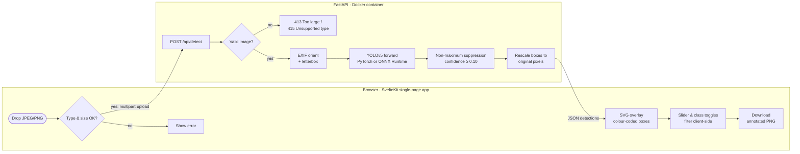

# MIFvsOV

Minute intestinal fluke (MIF) egg and _Opisthorchis viverrini_ (OV) egg detection and classification in microscopic images.

Upload a micrograph and the YOLOv5 model (`best.pt`, trained in 2022) finds MIF and OV eggs. The browser draws the boxes and lets you filter them by confidence and class, then download an annotated PNG.

Training notebook:
[](https://colab.research.google.com/drive/1AQdwrTNCkxA3wdRwyt-6WTWPSt4MeMim?usp=sharing)<br>
Dataset: [Eggs.zip](https://drive.google.com/file/d/1eo3-4ODNEwVi85MNfGSvZ3XWetZEgHem/view?usp=sharing) (from Phramongkutklao hospital's laboratory and ICIP 2022 challenge's dataset[^1])<br><br>
Example images batch:<br><br>


## Architecture



- The model is loaded once at startup, on PyTorch (`best.pt`) or ONNX Runtime (`best.onnx`); see [Inference runtime](#inference-runtime).
- Pre- and post-processing are plain NumPy, shared by both runtimes.
- The server returns every detection with confidence ≥ 0.10. All further filtering happens in the browser, without another request.

| Path                            | What                                                                       |
| ------------------------------- | -------------------------------------------------------------------------- |
| `backend/app/main.py`           | FastAPI app factory; loads the model in `lifespan`, mounts the SPA         |
| `backend/app/api/routes.py`     | `/api/health`, `/api/model`, `/api/detect`                                 |
| `backend/app/inference/`        | `detector.py` (NumPy pre/post-processing), `backends/` (torch, onnx), `models/` (trimmed YOLOv5 classes) |
| `backend/weights/best.pt`       | the 2022 weights, byte-identical (sha256 `3df91454…5cc9f`)                 |
| `backend/weights/best.onnx`     | exported from `best.pt` by `backend/scripts/export_onnx.py`                |
| `backend/tests/`                | API tests + parity tests against the original 2022 pipeline               |
| `frontend/`                     | SvelteKit app (`adapter-static`)                                           |
| `Dockerfile`, `docker-compose.yml` | multi-stage build: node → python slim                                   |

### API

`POST /api/detect` takes a multipart `file` (JPEG or PNG, ≤ 5 MB) and an optional `?conf=` (default 0.10). It returns:

```json
{
  "image": { "width": 3840, "height": 2160 },
  "detections": [
    { "class_id": 0, "label": "MIF", "confidence": 0.63, "x1": 1654.6, "y1": 739.6, "x2": 1911.1, "y2": 913.2 }
  ],
  "inference_ms": 140.2,
  "model": { "names": ["MIF", "OV"] }
}
```

- Box coordinates are pixels of the original image, after EXIF rotation.
- The client's slider (default 0.25, the old app's threshold) filters the results locally.
- Errors: `413` file too large, `415` not a decodable JPEG/PNG, `422` bad `conf`.
- Interactive docs are at `/docs`.

## Run it

### Docker (production-like)

```sh
docker compose up --build
# open http://localhost:8000
```

The image listens on `$PORT` (default 8000), runs as a non-root user and has a `HEALTHCHECK` on `/api/health`, so it runs as-is on Fly.io, Render, Railway, Hugging Face Spaces (Docker) or any VPS.

### Local development

Requirements: [uv](https://docs.astral.sh/uv/), Node 24 and pnpm (`corepack enable`).

```sh
# backend: http://localhost:8000
cd backend
uv sync
uv run uvicorn app.main:app --reload

# frontend: http://localhost:5173 (proxies /api to :8000)
cd frontend
pnpm install
pnpm dev
```

Or run both in containers with hot reload: `docker compose --profile dev up`.

### Configuration

Settings are read from environment variables with the `MIFVSOV_` prefix (see `backend/app/config.py`):

| Variable                 | Default                 | Meaning                                       |
| ------------------------ | ----------------------- | --------------------------------------------- |
| `MIFVSOV_RUNTIME`        | `torch`                 | `torch` or `onnx`, see below                  |
| `MIFVSOV_DETECT_CONF`    | `0.10`                  | server-side confidence floor                  |
| `MIFVSOV_CONF`           | `0.25`                  | default slider value shown to clients         |
| `MIFVSOV_IOU`            | `0.45`                  | non-maximum suppression IoU threshold         |
| `MIFVSOV_MAX_UPLOAD_MB`  | `5`                     | upload limit                                  |
| `MIFVSOV_NUM_THREADS`    | library default         | torch / onnxruntime intra-op threads          |
| `MIFVSOV_CORS_ORIGINS`   | `[]`                    | JSON list, only needed for cross-origin dev   |

`.env.example` lists every setting. Copy it to `.env` for `docker compose`.

### Inference runtime

The same model runs on either runtime. Both pass the strict 2022 parity tests.

|                                   | `torch` (default)  | `onnx`               |
| --------------------------------- | ------------------ | -------------------- |
| Weights                           | `best.pt`          | `best.onnx`          |
| Docker image (disk / compressed)  | 1.68 GB / 388 MB   | 605 MB / 170 MB      |
| Start → healthy at 0.1 CPU        | 47 s               | 31 s                 |
| Idle memory                       | 254 MB             | 162 MB               |
| Peak memory (see below)           | 366 MB             | 321 MB               |

#### Choosing a runtime

```sh
# Docker installs only one runtime, chosen at build time (the image sets MIFVSOV_RUNTIME to match)
docker build --target runtime --build-arg RUNTIME=onnx .
RUNTIME=onnx docker compose up --build    # or put RUNTIME=onnx in .env

# Local: `uv sync` installs both, so just set the variable
MIFVSOV_RUNTIME=onnx uv run uvicorn app.main:app
```

If the selected runtime isn't installed, startup fails with a message naming the build arg.

#### Re-exporting after changing `best.pt`

```sh
cd backend
uv run python -m scripts.export_onnx          # export, then compare torch and onnxruntime on the fixtures
uv run python -m scripts.export_onnx --check  # what CI runs: is best.onnx exported from today's best.pt?
```

Commit the new `best.onnx`. Notes on the export:

- It stores the class names, stride and `best.pt`'s sha256 as metadata, so the ONNX image never unpickles `best.pt`.
- Raw outputs match torch within 0.01 px on boxes and 1e-5 on scores.
- It is 28 MB: `best.pt` stores fp16 weights, the export is fp32.

#### Memory check

`backend/scripts/memcheck.sh IMAGE` runs an image with 512 MB and 0.1 CPU. It posts a 4032×3024 JPEG and a 2400×1800 PNG (once each, then 10 in a row, then 2 at once) and reports cgroup memory. The table above shows its results.

## Tests

```sh
cd backend  && uv run pytest              # API + parity tests, on both runtimes
cd frontend && pnpm check && pnpm lint && pnpm test
cd frontend && pnpm test:e2e              # Playwright, against the real backend
```

Every detector and API test runs on both `torch` and `onnx`.

**Parity with 2022.** `backend/tests/fixtures/parity.json` holds detections from the original pipeline (torch 1.11, `torch.hub.load('yolov5-master', 'custom', ...)`, size 640). The test requires:

- the same classes and count
- box IoU ≥ 0.99
- confidence within ±0.01

JPEG decoding changed between Pillow 8.4 and today's libjpeg-turbo, which alone moves confidences by a few hundredths. So `batch_decoded-pillow8.png` stores the exact pixels the old stack saw for `batch.jpg`, and a separate, looser test covers the modern decoder.

**Other checks:**

- `test_backends.py`: `best.onnx` is exported from the current `best.pt` and matches torch.
- `test_preprocess.py`: the NumPy code against the torch/torchvision code it replaced. Non-maximum suppression is identical; the letterbox differs by at most one level on ≤ 0.0012% of values.

After changing the API schema, run `pnpm gen:api` in `frontend/` to regenerate the TypeScript types from FastAPI's OpenAPI spec.

## Credits

Kasetsart University.

`backend/app/inference/models/` holds a trimmed copy of [YOLOv5](https://github.com/ultralytics/yolov5) by Ultralytics, from the version used to train `best.pt`, which was licensed under **GPL-3.0** (see `backend/app/inference/models/LICENSE`).

[^1]: Duangdao Palasuwan, Korranat Naruenatthanaset, Thananop Kobchaisawat, Thanarat H Chalidabhongse, Nuntiporn Nunthanasup, Kanyarat Boonpeng, Nantheera Anantrasirichai, January 22, 2022, "Parasitic Egg Detection and Classification in Microscopic Images", IEEE Dataport, doi: https://dx.doi.org/10.21227/vyh8-4h71.
