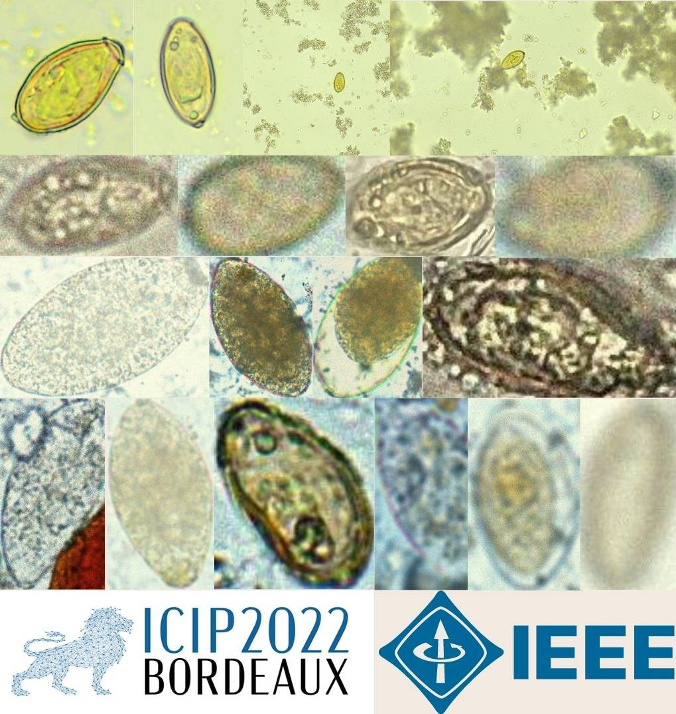

# MIFvsOV

Minute intestinal fluke (MIF) egg and _Opisthorchis viverrini_ (OV) egg detection and classification in microscopic images.

Upload a micrograph and the YOLOv5 model (`best.pt`, trained in 2022) finds MIF and OV eggs. The browser draws the boxes and lets you filter them by confidence and class, then download an annotated PNG.

Training notebook:
[](https://colab.research.google.com/drive/1AQdwrTNCkxA3wdRwyt-6WTWPSt4MeMim?usp=sharing)<br>
Dataset: [Eggs.zip](https://drive.google.com/file/d/1eo3-4ODNEwVi85MNfGSvZ3XWetZEgHem/view?usp=sharing) (from Phramongkutklao hospital's laboratory and ICIP 2022 challenge's dataset[^1])<br><br>
Example images batch:<br><br>


## Architecture

```
browser ── SvelteKit SPA (Svelte 5, Tailwind v4, shadcn-svelte)
   │          draws boxes as an SVG overlay, client-side conf slider / class toggles
   ▼
FastAPI  ── POST /api/detect  -> JSON detections
   │        GET  /api/model, /api/health
   │        serves the SPA build as static files in production
   ▼
Detector ── letterbox → YOLOv5 forward (plain PyTorch) → NMS → rescale
            loads the original best.pt via a small vendored copy of YOLOv5's model classes
```

| Path                            | What                                                                       |
| ------------------------------- | -------------------------------------------------------------------------- |
| `backend/app/main.py`           | FastAPI app factory; loads the model in `lifespan`, mounts the SPA         |
| `backend/app/api/routes.py`     | `/api/health`, `/api/model`, `/api/detect`                                 |
| `backend/app/inference/`        | `detector.py` (pre/post-processing) and `models/` (trimmed YOLOv5 classes) |
| `backend/weights/best.pt`       | the 2022 weights, byte-identical (sha256 `3df91454…5cc9f`)                 |
| `backend/tests/`                | API tests + parity tests against the original 2022 pipeline               |
| `frontend/`                     | SvelteKit app (`adapter-static`)                                           |
| `Dockerfile`, `docker-compose.yml` | multi-stage build: node → python slim                                   |

### API

`POST /api/detect` takes a multipart `file` (JPEG or PNG, ≤ 5 MB) and an optional `?conf=` (default 0.10). It returns:

```json
{
  "image": { "width": 3840, "height": 2160 },
  "detections": [
    { "class_id": 0, "label": "MIF", "confidence": 0.63, "x1": 1654.6, "y1": 739.6, "x2": 1911.1, "y2": 913.2 }
  ],
  "inference_ms": 140.2,
  "model": { "names": ["MIF", "OV"] }
}
```

Box coordinates are pixels of the original image, after EXIF rotation. The server returns everything at or above 0.10, and the client's slider (default 0.25, the old app's threshold) filters without another request. Errors: `415` for a file that isn't JPEG/PNG or can't be decoded, `413` for one that's too large, `422` for a bad `conf`. Interactive docs are at `/docs`.

## Run it

### Docker (production-like)

```sh
docker compose up --build
# open http://localhost:8000
```

The image listens on `$PORT` (default 8000), runs as a non-root user and has a `HEALTHCHECK` on `/api/health`, so it runs as-is on Fly.io, Render, Railway, Hugging Face Spaces (Docker) or any VPS.

### Local development

Requirements: [uv](https://docs.astral.sh/uv/), Node 24 and pnpm (`corepack enable`).

```sh
# backend: http://localhost:8000
cd backend
uv sync
uv run uvicorn app.main:app --reload

# frontend: http://localhost:5173 (proxies /api to :8000)
cd frontend
pnpm install
pnpm dev
```

Or run both in containers with hot reload: `docker compose --profile dev up`.

### Configuration

Settings are read from environment variables with the `MIFVSOV_` prefix (see `backend/app/config.py`):

| Variable                 | Default                 | Meaning                                       |
| ------------------------ | ----------------------- | --------------------------------------------- |
| `MIFVSOV_DETECT_CONF`    | `0.10`                  | server-side confidence floor                  |
| `MIFVSOV_CONF`           | `0.25`                  | default slider value shown to clients         |
| `MIFVSOV_IOU`            | `0.45`                  | NMS IoU threshold                             |
| `MIFVSOV_MAX_UPLOAD_MB`  | `5`                     | upload limit                                  |
| `MIFVSOV_NUM_THREADS`    | torch default           | `torch.set_num_threads`                       |
| `MIFVSOV_CORS_ORIGINS`   | `[]`                    | JSON list, only needed for cross-origin dev   |

## Tests

```sh
cd backend  && uv run pytest              # API + parity tests
cd frontend && pnpm check && pnpm lint && pnpm test
cd frontend && pnpm test:e2e              # Playwright, against the real backend
```

**Parity:** `backend/tests/fixtures/parity.json` holds detections from the original 2022 pipeline (torch 1.11, `torch.hub.load('yolov5-master', 'custom', ...)`, size 640). The test requires the same classes and count, box IoU ≥ 0.99 and confidence within ±0.01. JPEG decoding changed between Pillow 8.4 and today's libjpeg-turbo, which alone moves confidences by a few hundredths on busy images. So `batch_decoded-pillow8.png` stores the exact pixels the old stack saw for `batch.jpg`, and a separate, looser test covers the modern decoder.

After changing the API schema, run `pnpm gen:api` in `frontend/` to regenerate the TypeScript types from FastAPI's OpenAPI spec.

## Credits

Kasetsart University.

`backend/app/inference/models/` holds a trimmed copy of [YOLOv5](https://github.com/ultralytics/yolov5) by Ultralytics, from the version used to train `best.pt`, which was licensed under **GPL-3.0** (see `backend/app/inference/models/LICENSE`).

[^1]: Duangdao Palasuwan, Korranat Naruenatthanaset, Thananop Kobchaisawat, Thanarat H Chalidabhongse, Nuntiporn Nunthanasup, Kanyarat Boonpeng, Nantheera Anantrasirichai, January 22, 2022, "Parasitic Egg Detection and Classification in Microscopic Images", IEEE Dataport, doi: https://dx.doi.org/10.21227/vyh8-4h71.
